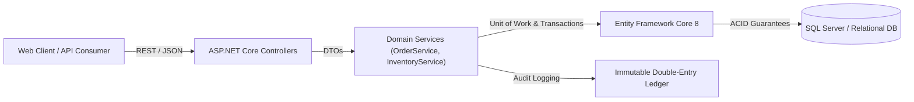

# Ledgr — Transactional Inventory & Order Platform

[](https://github.com/harsh-parakh22/Ledgr/actions/workflows/build-test.yml)
[](https://dotnet.microsoft.com/)
[](https://opensource.org/licenses/MIT)
[](#testing--tdd)

> A high-concurrency SaaS inventory and order management platform built in **C# / ASP.NET Core** and **Entity Framework Core**, featuring an **immutable double-entry stock ledger** and **ACID database transactions** to eliminate overselling and race conditions across multi-channel sales.

---

## 🏛️ System Architecture



---

## 🚀 Key Differentiators (Why Ledgr vs. Generic Inventory Apps)

| Problem in Generic Apps | Ledgr Solution | Enterprise Value |
| :--- | :--- | :--- |
| **Race Conditions / Overselling** | Order fulfillment wrapped in explicit database transactions (`BeginTransactionAsync`). | Eliminates double-spend when concurrent checkouts hit low stock items. |
| **Silent Stock Drifts** | Double-entry style audit ledger (`InventoryMovement`) logging deltas, snapshots, and reasons. | Complete operational auditability for finance & warehouse teams. |
| **Unformatted Exceptions** | Centralized middleware returning RFC 7807 `ProblemDetails` JSON. | Clean client-side error handling for integrations. |
| **No Automated Verification** | Built using strict **Test-Driven Development (TDD)** with xUnit & FluentAssertions. | Guaranteed zero regression on core business rules. |

---

## 🛠️ Technology Stack

- **Backend:** C# 12, .NET 8 (LTS), ASP.NET Core Web API
- **Persistence & ORM:** Entity Framework Core 8 (SQL Server / In-Memory provider)
- **Architecture:** Clean Architecture, N-Tier, Dependency Injection, RFC 7807 Global Exception Handling
- **Frontend:** HTML5, Modern Bootstrap 5, Vanilla JavaScript (ES6 Fetch API)
- **Testing:** xUnit, FluentAssertions, Moq
- **CI/CD:** GitHub Actions Automated Test Runner

---

## 📖 Engineering Documentation Suite

Detailed pre-development and architectural documentation is available in [`/docs`](./docs):

- 📄 [**Product Requirements Document (PRD)**](./docs/PRD.md)
- 🏗️ [**Technical Architecture & System Design**](./docs/ARCHITECTURE.md)
- 🗄️ [**Database Design & Schema Specification**](./docs/DATABASE_DESIGN.md)
- 🔌 [**API Specification & Contracts**](./docs/API_SPECIFICATION.md)
- 🧪 [**Testing Strategy & TDD Matrix**](./docs/TESTING_STRATEGY.md)
- 🤝 [**Contributing & Branching Guide**](./CONTRIBUTING.md)

---

## ⚡ Quick Start Guide

### Prerequisites
- [.NET 8.0 SDK](https://dotnet.microsoft.com/download/dotnet/8.0)
- Git

### 1. Clone & Run
```bash
git clone https://github.com/harsh-parakh22/Ledgr.git
cd Ledgr
dotnet run --project Ledgr.Api/Ledgr.Api.csproj
```

Open your browser to:
- **Interactive UI Dashboard:** `http://localhost:5000` (or `https://localhost:7001`)
- **Swagger OpenAPI Docs:** `http://localhost:5000/swagger`

---

## 🧪 Testing & TDD

Run the full xUnit automated test suite:

```bash
dotnet test
```

Sample output:
```text
Passed!  - Failed: 0, Passed: 5, Skipped: 0, Total: 5 - Ledgr.Tests.dll (net8.0)
```

---

## 👤 Author

**Harsh Parakh**  
- LinkedIn: [linkedin.com/in/harsh-parakh22](https://www.linkedin.com/in/harsh-parakh22/)  
- GitHub: [@harsh-parakh22](https://github.com/harsh-parakh22)

