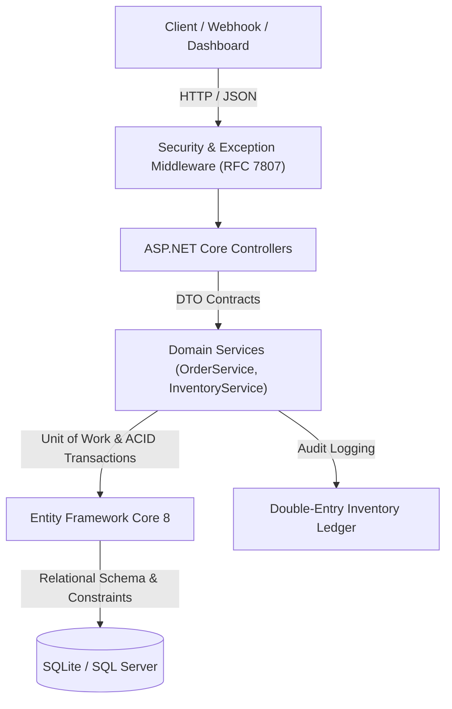

# Ledgr — Transactional Inventory & Order Platform

[](https://github.com/harsh-parakh22/Ledgr/actions/workflows/build-test.yml)
[](https://dotnet.microsoft.com/)
[](./LICENSE)
[](https://github.com/harsh-parakh22/Ledgr/releases)
[](./docs/quality/TESTING_STRATEGY.md)

**A high-concurrency SaaS inventory and order allocation engine for multi-channel product sellers, built to eliminate overselling and audit blind spots through an immutable, double-entry stock ledger.**

---

## 📸 Dashboard Overview

<!-- Replace the placeholder below with your screenshot (e.g. assets/dashboard.png) -->
```
+---------------------------------------------------------------------------------------------------+
|  LEDGR  [ Active Products: 42 ]  [ Low Stock: 3 ]  [ Open Orders: 8 ]  [ Valuation: $84,920.00 ]  |
+---------------------------------------------------------------------------------------------------+
|  [ Products ]   [ Orders ]   [ Stock Movements Ledger ]                                           |
|  -----------------------------------------------------------------------------------------------  |
|  SKU-LOGI-MX3S  | Logitech MX Master 3S  | In Stock: 45 | Reorder: 10  |  [ Healthy ]   [ Adjust ]    |
|  SKU-KCH-K2V2   | Keychron K2 Keyboard   | In Stock:  8 | Reorder: 10  |  [ LOW STOCK ] [ Restock ]   |
|  SKU-ANKR-737   | Anker 737 PowerBank    | In Stock:  3 | Reorder:  8  |  [ CRITICAL ]  [ Restock ]   |
+---------------------------------------------------------------------------------------------------+
```
> *Clean, zero-dependency operator dashboard built on vanilla ES6 JavaScript and Bootstrap 5 with real-time stock alert indicators.*

---

## 🥊 What Makes Ledgr Different?

Most inventory tutorials and lightweight e-commerce plugins treat stock as a simple mutable integer (`stock = stock - 1`), creating race conditions and silent stock drift.

| Problem Space | Spreadsheets & Basic Apps | Shopify / WooCommerce Plugins | Traditional ERPs (SAP/NetSuite) | **Ledgr Core** |
| :--- | :--- | :--- | :--- | :--- |
| **Concurrent Checkouts** | ❌ Race conditions, overselling | ⚠️ Eventual consistency delays | ✅ Transactional locking | **✅ ACID DB Transactions (`BeginTransactionAsync`)** |
| **Audit Trail** | ❌ Manual notes | ⚠️ Webhook logs only | ✅ Complex financial journal | **✅ Double-Entry Stock Movement Ledger** |
| **Stock Balance Invariant** | ❌ Easily desynced | ⚠️ Drift requires manual sync | ✅ Strict | **✅ Mathematical Invariant: $Stock = \sum Movements$** |
| **Concurrency Safeguard** | ❌ None | ⚠️ Optimistic with quiet overwrites | ✅ Heavy row-level locks | **✅ Optimistic Concurrency Tokens (`RowVersion`)** |
| **Error Format** | ❌ Unhandled crashes | ⚠️ Vendor-specific format | ⚠️ Custom XML/RPC | **✅ Standardized RFC 7807 `ProblemDetails`** |

---

## 🏗️ Architecture & How It Was Built

Ledgr is engineered following **Clean Architecture** principles with explicit boundaries between HTTP handling, domain services, and persistence:



### Concurrency & The "Single Stock Mutation Path"
- **Zero Direct Updates:** No endpoint or controller can directly mutate `Product.QuantityOnHand`.
- **Atomic Unit of Work:** Order placement validates stock, reserves items, appends audit rows, and updates product balances inside a single transaction. If any item is short of stock, the entire order rolls back cleanly.
- **Idempotency Keys:** Supports `Idempotency-Key` headers on order submissions to prevent duplicate charges or double deductions during network retries.

---

## 📦 Grouped Capabilities (By Job)

### 1. Stock Control & Catalog Management
- Full catalog lifecycle with unique SKU enforcement, categories, pricing, and reorder thresholds.
- Soft-deactivation (`IsActive = false`) preserving historic order relationships and reporting.
- Paged and filtered queries by SKU substring, category, and low-stock urgency.

### 2. Atomic Order Allocation & Fulfillment
- Multi-item customer order creation with atomic stock reservation.
- Idempotent order processing preventing double allocations on client retries.
- Safe order cancellations with automated stock replenishment and ledger logging.

### 3. Immutable Double-Entry Audit Ledger
- Immutable `InventoryMovement` entries for every physical change: `StockIn` (PO received), `OrderFulfill` (sales), `Adjustment` (cycle count), and `WriteOff` (damaged/lost goods).
- Enforces the ledger balance equation: $NewQuantity = PreviousQuantity + QuantityChange$.

### 4. Real-Time Operational Intelligence
- High-level KPIs: Total Active Products, Low-Stock Alert Count, Open Orders, and Total Dollar Inventory Valuation.
- Early warning indicator badges for products operating at or below `ReorderLevel`.

---

## ⚡ Quick Start & Run Locally

### Prerequisites
- [.NET 8.0 SDK](https://dotnet.microsoft.com/download/dotnet/8.0)
- Git

### 1. Clone & Run
```bash
git clone https://github.com/harsh-parakh22/Ledgr.git
cd Ledgr
dotnet run --project src/Ledgr.Api
```

Open your browser:
- **Web Dashboard:** `http://localhost:5000`
- **Interactive Swagger OpenAPI:** `http://localhost:5000/swagger`

---

## 🧪 Testing & Quality Assurance

Ledgr was built using strict **Test-Driven Development (TDD)** with 100% invariant verification across boundary conditions:

```bash
# Run complete test suite (46 automated tests)
dotnet test

# Run with strict 90%+ line coverage enforcement
dotnet test /p:CollectCoverage=true /p:Threshold=90 /p:ThresholdType=line
```

```text
Passed!  - Failed: 0, Passed: 46, Skipped: 0, Total: 46, Duration: 2 s - Ledgr.Tests.dll (net8.0)
```

---

## 📡 Instant API Verification (cURL)

Place an order and verify atomic stock deduction in one command:

```bash
curl -X POST http://localhost:5000/api/orders \
  -H "Content-Type: application/json" \
  -H "Idempotency-Key: ORD-DEMO-001" \
  -d '{
    "customerName": "Acme Retail Ltd",
    "customerEmail": "orders@acme.com",
    "items": [
      { "productId": 1, "quantity": 2 }
    ]
  }'
```

---

## 🚀 Production Deployment & Environments

### Configuration
Ledgr supports zero-friction local SQLite or enterprise Microsoft SQL Server via `appsettings.json` or Environment Variables:

| Environment Variable | Description | Default |
| :--- | :--- | :--- |
| `Database__Provider` | Database engine (`Sqlite` or `SqlServer`) | `Sqlite` |
| `ConnectionStrings__DefaultConnection` | SQL Server / SQLite connection string | `Data Source=ledgr.db` |
| `ASPNETCORE_ENVIRONMENT` | Hosting environment (`Development` / `Production`) | `Production` |

### Running with Docker
```bash
docker build -t ledgr-api:latest -f src/Ledgr.Api/Dockerfile .
docker run -d -p 5000:8080 --name ledgr ledgr-api:latest
```

---

## 🗺️ Product Roadmap

- **Current (v0.2.0):** Single-warehouse core, ACID transactions, double-entry stock ledger, RFC 7807 error handling, responsive UI dashboard.
- **Next (v0.3.0):** Multi-location warehouse inventory partitioning, stock transfer requests, CSV/Excel bulk catalog import.
- **Future:** Webhook ingestion endpoints for Shopify/Amazon order sync, automated AI restock purchase order draft generator.
- **Out of Scope:** Consumer shopping cart UI, payment gateway processing (Stripe/PayPal).

---

## 📚 Complete Engineering Documentation

Detailed architecture specifications and pre-development documents are organized in [`/docs`](./docs):

- 📄 [**Product Requirements Document (PRD)**](./docs/product/PRD.md)
- 🏗️ [**Technical Architecture & System Design**](./docs/architecture/ARCHITECTURE.md)
- 🗄️ [**Database Design & Concurrency Invariants**](./docs/architecture/DATABASE_DESIGN.md)
- 🔌 [**API Specification & Contracts**](./docs/api/API_SPECIFICATION.md)
- 🧪 [**Testing Strategy & Quality Plan**](./docs/quality/TESTING_STRATEGY.md)
- 📜 [**Changelog & Release Notes**](./CHANGELOG.md)
- 🤝 [**Contributing Guide**](./CONTRIBUTING.md)
- 🔒 [**Security Policy**](./SECURITY.md)

---

## 👤 Author

**Harsh Parakh**  
- LinkedIn: [linkedin.com/in/harshparakh](https://linkedin.com/in/harshparakh)  
- GitHub: [@harsh-parakh22](https://github.com/harsh-parakh22)  
- Portfolio: [harshparakh.work@gmail.com](mailto:harshparakh.work@gmail.com)
