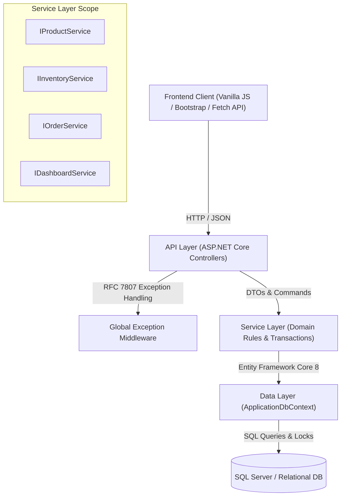
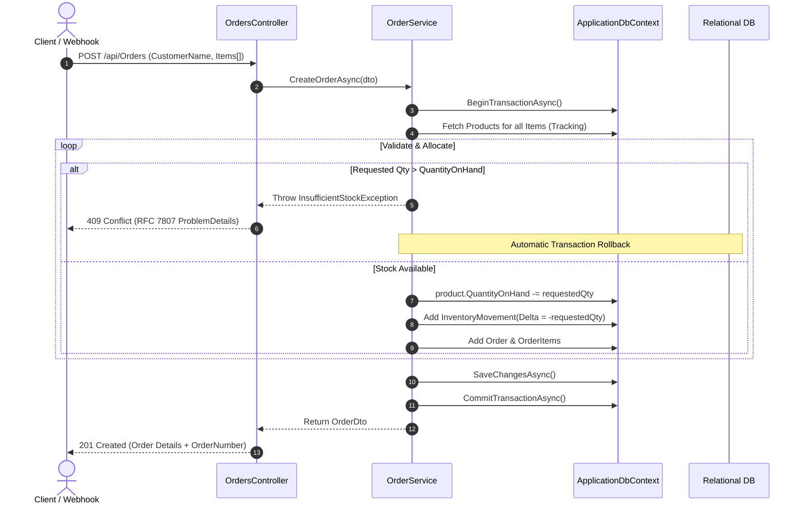

# Technical Architecture & System Design Document (TDD / HLD) — Ledgr

**Document Version:** 1.0.0  
**Status:** Approved  
**Author:** Harsh Parakh  

---

## 1. Architectural Overview & Style

Ledgr is engineered following the **Clean Architecture / N-Tier Domain-Centric Pattern** with explicit separation between **Domain Entities**, **Business Services**, **Persistence (EF Core)**, and **API/Presentation Layers**.



---

## 2. Concurrency & Transaction Boundary Design

### 2.1 The Race Condition Threat (Double-Spend / Overselling)
In an e-commerce or retail fulfillment engine, concurrent checkout requests for the same SKU can cause overselling:

```
Thread A: Reads Stock = 1
Thread B: Reads Stock = 1
Thread A: Decrements (1 - 1 = 0) and commits.
Thread B: Decrements (1 - 1 = 0) and commits.
Result: 2 orders confirmed for 1 physical unit! (Stockout deficit)
```

### 2.2 Ledgr Concurrency Resolution
Ledgr enforces **Atomic Unit of Work with Database Transactions**:
1. Order creation initiates an explicit `IDbContextTransaction` via `BeginTransactionAsync()`.
2. The `IExecutionStrategy` pattern handles transient connection retries cleanly.
3. Inventory balances are evaluated and updated within the transaction boundary.
4. If validation fails for *any* line item, `RollbackAsync()` is invoked automatically, preventing partial allocations.



---

## 3. Component Architecture & Responsibilities

| Component | Namespace | Responsibility |
| :--- | :--- | :--- |
| **`Models`** | `Ledgr.Api.Models` | Pure domain entities (`Product`, `InventoryMovement`, `Order`, `OrderItem`). |
| **`DTOs`** | `Ledgr.Api.DTOs` | Immutable record structures (`record`) for strong typed API input/output validation. |
| **`Data`** | `Ledgr.Api.Data` | EF Core DbContext, entity fluent configurations, indexes, precision definitions, and database seeder. |
| **`Services`** | `Ledgr.Api.Services` | Core business logic, transaction isolation, stock validation, and ledger invariant enforcement. |
| **`Middleware`** | `Ledgr.Api.Middleware` | Centralized exception handling formatting standard RFC 7807 JSON responses. |
| **`Controllers`** | `Ledgr.Api.Controllers` | Thin REST controllers delegating to domain services. |

---

## 4. Error Handling Architecture (RFC 7807)
All domain errors inherit from `LedgrException` with explicit HTTP status codes:
- `ProductNotFoundException` $\rightarrow$ `404 Not Found`
- `InsufficientStockException` $\rightarrow$ `409 Conflict`
- `InactiveProductException` $\rightarrow$ `400 Bad Request`
- `DuplicateSkuException` $\rightarrow$ `409 Conflict`

