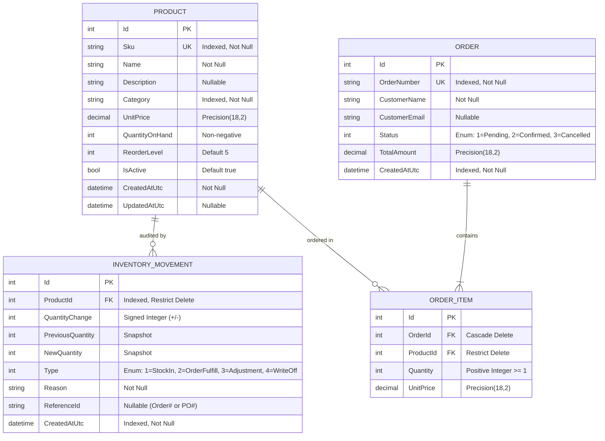

# Database Design & Schema Specification — Ledgr

**Document Version:** 1.0.0  
**Status:** Approved  
**Author:** Harsh Parakh  

---

## 1. Entity-Relationship (ER) Diagram

---

## 2. Mathematical Integrity Invariants of the Stock Ledger

The double-entry ledger enforces strict physical and mathematical invariants across every state transition:

1. **Balance Equation Invariant:**
   $$\text{NewQuantity} = \text{PreviousQuantity} + \text{QuantityChange}$$
2. **Current Stock Equation:**
   $$\text{Product.QuantityOnHand} = \sum_{i=1}^{N} \text{Movement}_i.\text{QuantityChange}$$
   *(The current stock on hand is mathematically proven by the sum of all historical movements for that product).*
3. **Non-Negativity Constraint:**
   $$\text{Product.QuantityOnHand} \ge 0 \quad \forall \text{ operations}$$
   *(Any transaction attempting to drive on-hand stock below 0 is aborted and rolled back).*

---

## 3. Indexing Strategy & Performance

| Table | Index Columns | Index Type | Reason |
| :--- | :--- | :--- | :--- |
| `Products` | `Sku` | Unique B-Tree | Fast $O(1)$ lookups and duplicate prevention across channels. |
| `Products` | `Category`, `IsActive` | Composite | Fast filtering for storefront catalog & active inventory. |
| `InventoryMovements`| `ProductId`, `CreatedAtUtc` | Composite | High-speed audit logs retrieval per product in chronological order. |
| `Orders` | `OrderNumber` | Unique B-Tree | Guaranteed idempotency and fast order retrieval. |
| `Orders` | `CreatedAtUtc` | B-Tree | High-speed range queries for revenue dashboards. |

