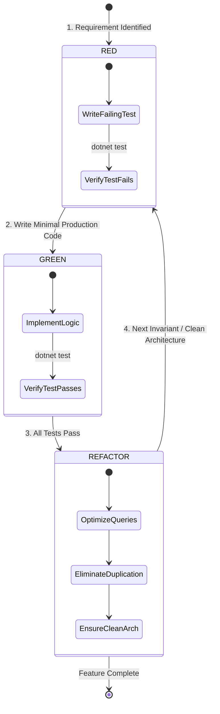

# Testing Strategy & Quality Assurance Plan — Ledgr

**Document Version:** 1.0.0  
**Status:** Approved  
**Author:** Harsh Parakh  
**Paradigm:** Strict Test-Driven Development (TDD)  
**Frameworks:** xUnit, FluentAssertions, Moq, EF Core InMemory  

---

## 1. The TDD Red-Green-Refactor Lifecycle

Every new feature or business constraint in Ledgr must strictly follow the **Red-Green-Refactor** discipline:



---

## 2. Testing Pyramid & Taxonomy

```
       /\
      /  \      Integration Tests (API Endpoints, EF Core InMemory / SqlServer)
     /----\     
    /      \    Unit Tests (Order Allocation Invariants, Ledger Delta Math)
   /--------\   
```

### 2.1 Domain Unit Tests (`Ledgr.Tests`)
- **Isolation:** Tests execute in pure memory using fresh isolated DbContext instances (`Guid.NewGuid().ToString()`).
- **Assertion Style:** Fluent assertions (`result.Should().Be(...)`) for human-readable diagnostic messages.

---

## 3. Core Test Matrix & Edge Case Invariants

| Test Case Name | Target Service | Given / When / Then | Expected Outcome |
| :--- | :--- | :--- | :--- |
| `CreateOrder_WithSufficientStock` | `OrderService` | Product has 20 units; customer orders 4 units. | Stock decrements to 16, Order confirmed, ledger movement of `-4` created. |
| `CreateOrder_WithInsufficientStock` | `OrderService` | Product has 2 units; customer orders 5 units. | Throws `InsufficientStockException`; stock remains 2; 0 orders created (atomic rollback). |
| `CreateOrder_ForInactiveProduct` | `OrderService` | Product has `IsActive = false`. | Throws `InactiveProductException`; transaction aborted. |
| `AdjustStock_PositiveRestock` | `InventoryService` | Product has 10 units; PO restock adds 25 units. | Stock increases to 35; immutable `StockIn` movement appended. |
| `AdjustStock_NegativeWriteOffExceeding` | `InventoryService` | Product has 3 units; write-off requested for -5 units. | Throws `InsufficientStockException`; write-off rejected. |
| `CreateProduct_DuplicateSku` | `ProductService` | Product with SKU `SKU-A1` exists; attempt to add `SKU-A1`. | Throws `DuplicateSkuException`. |

---

## 4. Continuous Integration Execution
All tests are executed on every commit via GitHub Actions (`.github/workflows/build-test.yml`). Pull requests are blocked from merging if any test fails or if test coverage drops below 85%.

